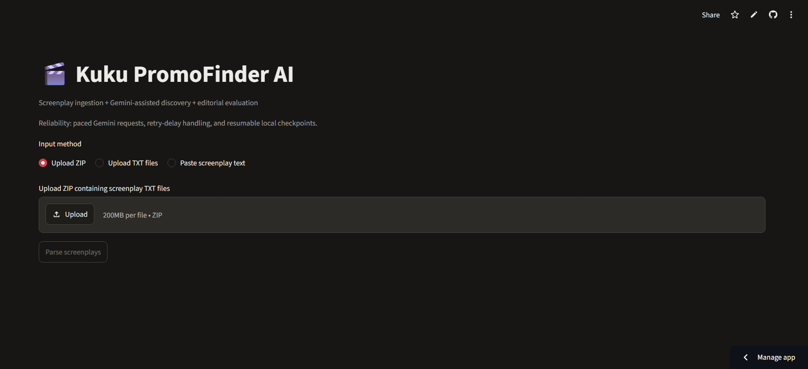
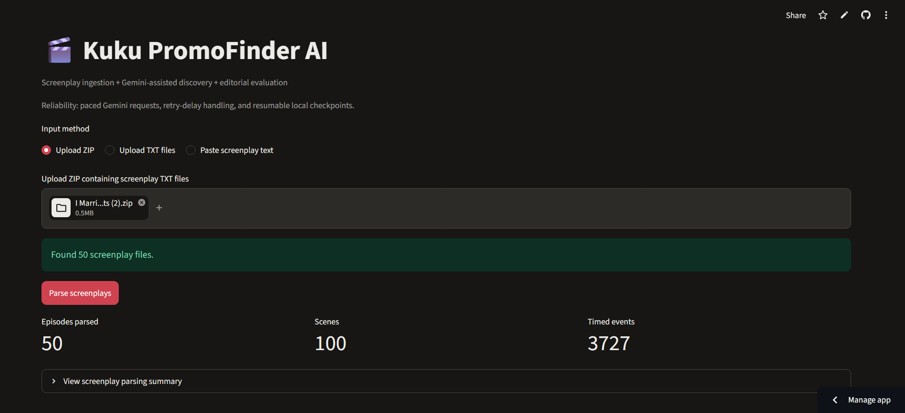
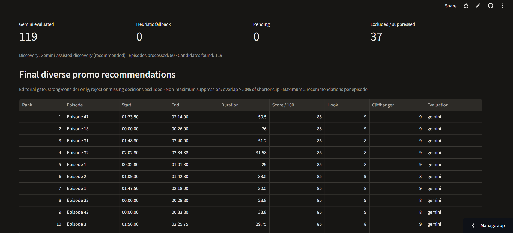
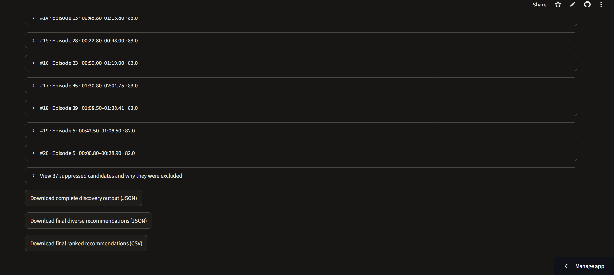

# 🎬 Kuku PromoFinder AI

**Gemini-assisted promotional clip discovery and editorial evaluation for screenplay content.**

[](https://kuku-promofinder-ai.streamlit.app/)
[](https://www.python.org/)
[](https://github.com/chandrakant1212/Kuku-PromoFinder-AI/actions)

Kuku PromoFinder AI analyzes screenplay events and identifies promising **20–60 second promotional clip candidates**. It uses **Google Gemini 3.5 Flash Lite** for candidate discovery and editorial evaluation, while Python enforces timestamp validity, duration limits, editorial eligibility, and recommendation diversity.

The application is designed to make promotional selection faster and more explainable: every candidate can be reviewed, ranked, exported, or excluded with an auditable reason.

## 🚀 Try It Online

- **Deployed application:** [kuku-promofinder-ai.streamlit.app](https://kuku-promofinder-ai.streamlit.app/)
- **Demo video:** [Watch the demo on Google Drive](https://drive.google.com/file/d/1txrzhdeZq6s5w0eGLTitvkUr5MZubAJ0/view)

## 📸 Application Preview

### Upload and parse screenplay files



The application accepts a ZIP archive containing screenplay `.txt` files, multiple `.txt` files, or pasted screenplay text.

### Review parsing results



After parsing, the app displays the number of episodes, scenes, and timed events detected.

### Review ranked recommendations



Recommendations include timestamps, duration, score, hook strength, cliffhanger potential, and evaluation source.

### Inspect exclusions and download results



The complete audit output includes excluded and suppressed candidates, while final recommendations are available as JSON and CSV downloads.

## ✨ Key Features

- **AI-assisted discovery:** Gemini identifies promising promotional moments from bounded screenplay event chunks.
- **Timestamp-safe selection:** Gemini returns event IDs; Python resolves them against the original screenplay timestamps.
- **Duration enforcement:** Candidates must be between 20 and 60 seconds and remain within episode boundaries.
- **Editorial evaluation:** Candidates are scored for hook strength, cliffhanger potential, emotional intensity, standalone clarity, risks, and overall recommendation.
- **Deterministic quality gate:** Only explicit `strong` and `consider` recommendations are eligible for the final shortlist. `reject`, missing, and unknown labels are excluded.
- **Diversity selection:** Temporal non-maximum suppression reduces overlapping clips, with a configurable per-episode recommendation cap.
- **Checkpoint and resume:** Successful discovery and evaluation results are cached so pending work can be resumed across runs.
- **Exportable results:** Download raw JSON, final recommendation JSON, and ranked CSV files.
- **Heuristic baseline:** Compare Gemini-assisted results with a non-LLM baseline. The baseline is not an AI editorial judgment.

## 🧭 How It Works

1. **Upload or paste screenplays** as `.txt` files.
2. **Parse scenes and timestamped events** from the screenplay files.
3. **Discover candidates** with Gemini 3.5 Flash Lite or the heuristic baseline.
4. **Resolve and validate timestamps** using the original event IDs.
5. **Build exact screenplay excerpts** for each selected interval.
6. **Evaluate candidates editorially** with Gemini.
7. **Apply deterministic eligibility rules** and remove rejected or invalid recommendations.
8. **Select diverse recommendations** using temporal overlap suppression and episode limits.
9. **Review and export** the results as JSON or CSV.

## 📝 Editorial Quality Gate

The categorical editorial decision is kept separate from the weighted numeric score:

| Gemini decision | Final shortlist |
|---|---|
| `strong` | Eligible |
| `consider` | Eligible |
| `reject` | Excluded |
| Missing or unrecognized | Excluded |

A high numeric score cannot override an explicit rejection. Excluded candidates remain in the raw JSON output with their exclusion reason, preserving the audit trail. Human editorial review is still required before publishing a promo.

## 📥 Input Format

The app accepts screenplay text files with timestamped events. A typical input contains scene headings and event timestamps, for example:

```text
SCENE 1 - INT. OFFICE - DAY

[00:12.50] MAYA enters the office and looks around.
[00:18.20] DANIEL reveals that the files are missing.
[00:31.00] MAYA finds a hidden envelope.
```

For batch processing, place one episode per `.txt` file in a ZIP archive. The filename is used as the source file label.

## 📊 Outputs

The Streamlit app provides three downloads:

- **Complete discovery output (JSON):** All discovered and evaluated candidates, including validation failures, editorial exclusions, suppression reasons, and pending/failed work where applicable.
- **Final diverse recommendations (JSON):** Candidates that pass editorial eligibility and diversity selection.
- **Final ranked recommendations (CSV):** A review-friendly table containing episode, timestamps, duration, score, hook, cliffhanger, and evaluation details.

Suppression reasons distinguish `editorial_reject`, `editorial_approval_missing_or_invalid`, `temporal_overlap`, and `episode_limit`.

## ⚙️ Local Installation

### Requirements

- Python 3.12 or newer
- A Google Gemini API key
- Screenplay `.txt` files

### Windows PowerShell

```powershell
git clone https://github.com/chandrakant1212/Kuku-PromoFinder-AI.git
cd Kuku-PromoFinder-AI
python -m venv .venv
.venv\Scripts\Activate.ps1
python -m pip install --upgrade pip
pip install -r requirements.txt
pip install -r requirements-dev.txt
```

### macOS or Linux

```bash
git clone https://github.com/chandrakant1212/Kuku-PromoFinder-AI.git
cd Kuku-PromoFinder-AI
python3 -m venv .venv
source .venv/bin/activate
python -m pip install --upgrade pip
pip install -r requirements.txt
pip install -r requirements-dev.txt
```

## 🔐 Configuration

Create a `.env` file in the project root:

```env
GEMINI_API_KEY=your_actual_api_key
GEMINI_MODEL=gemini-3.5-flash-lite
GEMINI_MIN_REQUEST_INTERVAL=1.0
```

`GEMINI_MIN_REQUEST_INTERVAL` controls the minimum delay between Gemini requests. Increase it when working with strict rate limits. On Streamlit Cloud, configure these values as application Secrets instead of committing a `.env` file.

Never commit API keys, screenplay files, generated checkpoints, or other private input material.

## ▶️ Run the Application

```bash
streamlit run app.py
```

Then open the local Streamlit URL shown in the terminal.

## 🧪 Run Tests

```bash
python -m pytest -v
```

GitHub Actions runs the test suite on pushes and pull requests targeting `main`.

## 🔁 Checkpoint and Resume

The application stores resumable state in `data/run_checkpoint.json`, which is ignored by Git.

To resume pending evaluations:

1. Keep the screenplay files and their contents unchanged.
2. Keep `data/run_checkpoint.json` in the same project folder.
3. Run the application again.
4. Click **Discover and evaluate promos**.
5. Repeat until the pending count reaches zero.

Successful discovery and evaluation results are reused. Failed Gemini calls are not treated as successful checkpointed evaluations and can be retried later.

## 🎛️ Discovery and Evaluation Controls

The interface lets you control:

- Candidate discovery method: Gemini-assisted or heuristic baseline
- Maximum discovered candidates per episode
- Maximum new candidates evaluated per run
- Number of episodes processed in a run
- Optional heuristic fallback when Gemini evaluation fails
- Temporal overlap threshold for suppression
- Maximum final recommendations per episode

For large screenplay packs, begin with a small number of episodes to verify output quality and API quota before processing the full set.

## 🛡️ Reliability and Limitations

- Gemini requests are paced and retry delays from HTTP 429 responses are respected.
- Candidate timestamps are resolved from supplied screenplay event timestamps rather than accepted as arbitrary model output.
- Python validates event IDs, ordering, duration, and episode boundaries.
- Chunk-based discovery can miss context spanning distant parts of an episode.
- Free or limited Gemini tiers may impose rate and quota limits.
- LLM recommendations are not guaranteed to be suitable promotional clips.
- Human editorial review remains necessary.

## 🗂️ Project Structure

```text
.
├── app.py                    # Streamlit application
├── src/
│   ├── parser.py             # Screenplay parsing
│   ├── candidate_generator.py
│   ├── llm_analyzer.py       # Gemini discovery and evaluation
│   ├── scoring.py            # Validation and scoring
│   └── ranking.py            # Diversity selection
├── tests/                    # Automated tests
├── docs/screenshots/         # README screenshots
├── requirements.txt          # Runtime dependencies
└── requirements-dev.txt      # Development/test dependencies
```

## 🔒 Security and Copyright

- Keep `.env` and Streamlit Secrets private.
- Do not expose API keys in source code, screenshots, logs, or generated files.
- Review generated JSON, CSV, and checkpoint files before committing.
- Do not publish screenplay files or other copyrighted/private input material without permission.

## 📌 Project Status

Kuku PromoFinder AI is an AI-assisted workflow for discovering, evaluating, and ranking promotional clip candidates from screenplay events. It combines Gemini editorial analysis with deterministic validation, eligibility rules, diversity selection, checkpointing, and human review.
